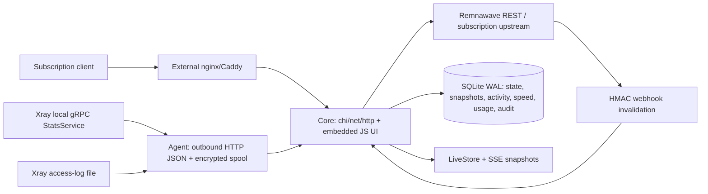

> Подробное состояние на момент исходного аудита 2026-10-13; текущая навигация — [PROJECT_PLAN](../PROJECT_PLAN.md).

# SubGate: фактическое состояние и план

Аудит рабочей копии: 2026-10-13, Windows/amd64, Go 1.26.2. Версия в текущем коде и Makefile — **0.2.0**; это идентификатор сборки, а не доказательство опубликованного или готового production-релиза. Новые функции и тесты в этом аудите не добавлялись.

## 1. Цель и границы

SubGate — самостоятельный многофункциональный продукт владельца, заменяющий remnawave-admin. Предметные интеграции: **Remnawave по `remnawave-openapi.json` и VPN-ноды**. Интеграция с remnawave-admin исключена текущим поручением. Panel остаётся источником истины для пользователей, срока/статуса подписки и собственного traffic accounting; SubGate добавляет свой gateway, телеметрию и операторские инструменты.

Источники требований — [prompt v4](../../subgate-ai-prompt-v4.md) и [feature inventory](../../subgate-feature-inventory.md), прочитанные целиком и сохранённые без изменений. Реестр ниже переносит исходные формулировки, включая условия, ограничения и критерии приёмки. `F-001…` — новые идентификаторы строк аудита; исходные F1…F36 остаются внутри цитат/разделов. Не отождествлять F-016 с исходным F16.

В inventory **Part B** задаёт объединённый каталог SubGate; **Part A** описывает чужие продукты. Его возможности также перечислены для полноты, с пометкой «референс»: они не становятся автоматически согласованным scope v1. Не объединены повторные формулировки и взаимоисключающие требования. Поэтому количество строк реестра — не количество независимых функций и не процент готовности.

В этой задаче разрешены аудит/документация и минимальные исправления сборки. Не реализовывать roadmap, не удалять код, не изменять два файла владельца, OpenAPI, модули, Makefile или deployment-механизмы. Billing/sales/CRM, payload/URL inspection и multi-tenant SaaS не входят в v4; статус редактора/abuse engine и некоторых внешних сервисов требует ответа владельца (раздел 7).

### Подготовка и происхождение изменений

Первый `git status --short` показал 23 modified tracked-файла и множество новых packages/tests/deploy/web/docs. По `git diff --stat` уже до аудита было 2388 добавленных и 2862 удалённых строк. `.gocache/` — untracked артефакты Go; добавлен только ignore для этого каталога. Остальные изменения относятся к уже существующей незакоммиченной разработке. Кто и каким запуском их сделал, по status/diff определить невозможно — **не проверено**; откатов/commit/staging не выполнялось.

Фактический статус четырёх специально указанных файлов: **go.mod modified**, **go.sum untracked**, **.dockerignore untracked**, **remnawave-openapi.json untracked**. Запрошенная предпосылка про untracked go.mod не подтвердилась. Эти файлы не изменены. Секреты, `.env`, ключи, существующие базы и backup-артефакты не открывались.

Указанные ошибки компиляции уже отсутствовали в начале аудита: `Server.journal` в `server.go` не конфликтует с методом `Server.activity` в `telemetry.go`; импорт `blocks` в `features.go` используется в `blockCheck`. Новых compile blockers не обнаружено; Go-код не потребовал правок. Go сообщал об отказе записи stat-cache модуля вне workspace, но `go build` завершился с кодом 0; это не ошибка компиляции.

## 2. Инварианты

Это требования к дальнейшей работе; приведённые оговорки отделяют их от уже доказанного поведения.

- Fail-open: исходная подписка при обычной ошибке transform/usage DB; bounded stale upstream snapshot, authoritative upstream 4xx не маскируются. **Пока не обеспечено:** recovery внутри transformer, 300 ms deadline и выдача при убитом Core через reverse proxy. Не считать `middleware.Recoverer` доказательством fail-open: panic может дать 500.
- Remnawave — источник пользователей/подписок; scoped API token только на Core. Agent использует отдельный revocable token, исходящие запросы; Xray API — local Unix/loopback. `QueryStats(reset=false)` всегда; внешнее обнуление счётчиков обрабатывается без отрицательных дельт.
- Opaque unknown subscription entries/неоднозначные mapping сохранять, не создавать пустую подписку. Тесты покрывают неизвестные URI/JSON/YAML, а не все версии/протоколы Xray.
- Без Docker socket и чтения чужих PostgreSQL-схем. Для access-log — файловый read-only доступ; не менять Xray sink на FIFO. Core/Agent не должны читать payload, URL или страницы — только destination host:port и connection metadata.
- Client IP брать из direct peer и явной trusted-proxy chain; IPv4-mapped IPv6 нормализовать. CDN headers, /64 grouping и CGNAT ещё отсутствуют.
- Шифровать чувствительные данные и не раскрывать секреты. Сейчас AES-GCM защищает activity payloads, gateway snapshots, local backup и token-bound Agent spool; **не всю SQLite БД и не panel/admin config**. IDs, node/user metadata, audit IP и usage лежат открыто в приватной БД. Core key хранится рядом с БД, spool key зависит от agent token; потеря/смена ключа влияет на восстановление.
- Sensitive activity access должен быть отдельно ограничен и полностью аудитирован. Сейчас viewer запрещён, admin/superadmin разрешены; отдельных `activity:read/export`, superadmin-only default, full query-filter audit и TOTP нет. Не описывать это как выполненную security-модель.
- Mutations injection/quota с audit commit атомарны. В enrollment-token/manual sync audit ошибки игнорируются; исправление только будущим этапом. Panel action audit происходит до вызова и не гарантирует правильный final status.
- TLS для удалённого Agent обязателен; Core допускает static certificate TLS или proxy termination. SSRF-защита diagnostic API есть для synced block-check target/allowlisted YouTube redirects; глобальная защита всех URL и panel private-range allowlist ещё не доказана.
- Linux — целевая production-платформа. Есть systemd/контейнерные шаблоны; build tags linux не применены, Agent содержит Windows ветку syncSpoolDirectory. Native Windows build/test этого аудита не доказывает production Linux.
- Ограничивать queue/storage, явно отражать gaps, не подставлять нули вместо отсутствующих измерений. Сейчас spool 16 MiB и bounded batches; hard RSS/disk budgets, full segment retention и cleanup всех usage/meta/diagnostics не реализованы.
- Любой статус DONE должен ссылаться на выполненный тест с нужными assertions или ручной runtime probe. Наличие package/table/config field/HTTP route, зелёный build и прежние ИИ-отчёты не доказывают функцию целиком.

## 3. Архитектура: как есть сейчас

Два отдельных Go executables (`core/cmd`, `agent/cmd`), не единый `subgate agent|probe`. UI `web/` — встроенные plain HTML/CSS/JS; без npm, Preact/TypeScript/Vite. Админ API `/api/v1`, health/version/metrics public; GET подписки `/sub/{shortUuid}[/{clientType}]` и короткие aliases. HEAD не зарегистрирован.

`panel.Client` написан вручную; хранится локальный OpenAPI **Remnawave 3.4.5**. Проверены имена используемых resource/action paths в spec и HTTP fixtures; scopes, полные response schemas/nullability и совместимость реальной установленной панели **не проверено**. `syncPanel` получает users с start/size, nodes, hosts, публикует snapshot транзакцией. Host fetch failure не блокирует commit — старые hosts могут исчезнуть; список users/nodes при fetch error сохраняется. Webhook проверяет HMAC/raw body/time/replay, очищает gateway cache; users/nodes меняются на периодическом sync, default 1 min без jitter.

Gateway хранит **upstream bytes**, TTL 30 s, stale максимум 5 min, memory limit 1024 entries, encrypted persistent snapshots. Device-aware запрос с HWID не использует свежий cached response. Concurrent requests коалесцируются собственными per-key mutex; `singleflight` библиотека не используется. Transform вычисляет pin либо первый policy с conditions country/ASN/UA, выбирает одну online node, фильтрует mapped endpoints URI/JSON/YAML, затем применяет injections. `leastLoad` использует panel UsersOnline; `leastPing` — manual probe <=10 min. Quarantine engine не подключён.

Квоты читают committed `sg_usage`, поддерживают user/node scope, calendar/timezone и fixed rolling 30 d; inbound intervals при overlap с user measurement консервативно исключаются. **При exhausted selected node возвращается исходная подписка**, не quota filtering. Alias resolution зависит от текущего panel cache; rename может изменить historical attribution. Для live alias map нет такой же защиты ambiguous aliases, как у activity/quota.

Agent читает динамически собранный gRPC protobuf descriptor (не generated minimal stubs), 1 s sampling `reset=false`, fallback inbound при отсутствии users, обрабатывает reset/warming/gap, измеряет query time; adaptive sampling нет. HTTP JSON telemetry/heartbeat, token-bound AES-GCM pending spool, same batch ID retries. Events ещё в RAM могут потеряться; новые batch IDs не обеспечивают event-level dedupe. Heartbeat каждые 30 s, memory_mb — Go heap Alloc, не host RAM/RSS.

`pkg/xray/logs.go` tail начинает с EOF, polling 100 ms, поддерживает partial lines/rename/copytruncate кодом; tests rotation/recreate не найдены. Передаёт только access events с email. Debug/error classifier существует отдельно и не подключён. Activity runtime — encrypted JSON event per SQLite row, HotTTL cleanup (default 14 d), query user/node/time/domain, CSV/JSON export, audited read/purge. Hot/warm/cold segment engine, coalescing и compact storage отсутствуют.

`LiveStore` индексирует user/node/scope, bounded 100000 identities и до 12 recent samples; EMA3/10, recent averages/peak/p95; SQL history собирается при чтении в 10 s buckets, не durable rollup tiers. SSE отправляет полный snapshot 1 Hz, не WebSocket diff. sg_speed удаляется после 24 h, sg_speed_meta/sg_usage не очищаются. IP intelligence — local prefix JSON/MMDB с manual atomic reload, longest-prefix/last-good; builder/feeds нет.

Утилиты, которые нельзя считать внедрёнными функциями: `health.Engine`, `tier.Tier`, `geoblock.Engine`, `webhook.Handler`, `logs.Aggregator`, `activity.Journal`, `backup.HTTPStore/TelegramStore/Prune`, legacy `tsdb.TSDB`. В частности `Journal` создан полем, но `AddEvent/Compact/Export` runtime не вызывает. `HTTPStore` использует custom headers, не S3 SigV4. Telegram sender подключён только к ручному test endpoint; bot команды и event lifecycle отсутствуют.

Deployment: non-root Alpine Dockerfiles, Core Compose с read-only root/drop caps/no-new-privileges, private persistent data volume, systemd units. `install.sh` устанавливает **локальные** готовые бинарники, optionally checksums, проверяет `-version=0.2.0`, сохраняет env и по умолчанию не запускает службы. Ни downloader/signatures/agent distribution, ни safe auto-updater нет. Caddy может получать сертификаты внешним процессом; встроенного Core ACME и fail-open fallback в proxy examples нет.

